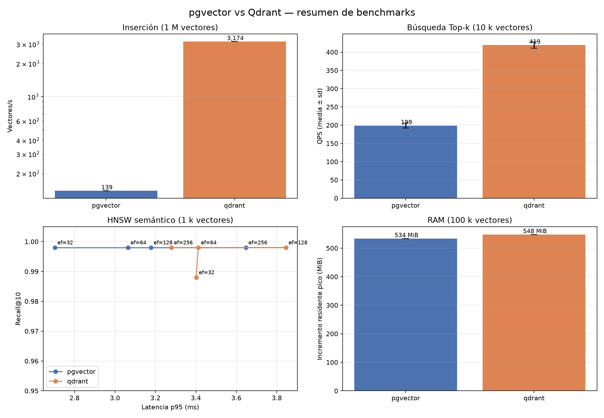
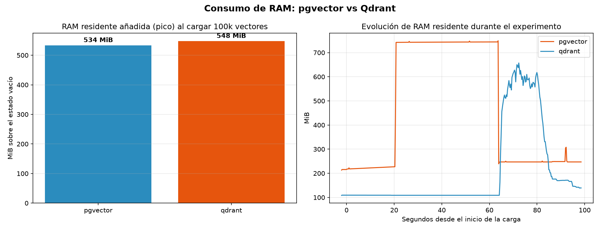

# Manual de benchmarks: pgvector vs Qdrant

Guía para ejecutar, entender e interpretar los benchmarks de este repositorio. Comparan **pgvector** (PostgreSQL) frente a **Qdrant** con vectores de **384 dimensiones** y distancia coseno. Incluye pruebas con datos sintéticos y una prueba de HNSW con embeddings de texto reales.

---

## 1. Requisitos y arranque

### 1.1 Entorno

- Python 3.13. En este equipo `python3` apunta a 3.12, así que **no uses `python3 -m venv`**: crearía el entorno con la versión equivocada.
- Docker + Docker Compose.
- `uv` (recomendado aquí) o un Python 3.13 con `pip` funcionando.
- Dependencias de `requirements.txt` (`sqlalchemy`, `asyncpg`, `pgvector`, `qdrant-client`, `numpy`, `pandas`, `matplotlib`, …).

```bash
cd ~/Desktop/labs/dbVec

# Opción A: uv (la usada en este proyecto). Elige UNA sola opción.
uv venv venv --python 3.13
uv pip install --python venv/bin/python -r requirements.txt
source venv/bin/activate
python --version        # debe decir 3.13.x

# Opción B: si tu Python 3.13 trae venv y pip
python3.13 -m venv venv
source venv/bin/activate
python -m pip install -r requirements.txt

# Motores de bases de datos:
docker compose up -d
docker compose ps
```

Si `venv/` ya existe, puedes saltar la creación y solo activarlo. Los entornos creados con `uv` no incluyen `pip`: usa siempre `uv pip install` con ellos.

| Servicio | Imagen | Endpoint | Credenciales |
|---|---|---|---|
| Qdrant | `qdrant/qdrant:v1.20.0` | `http://localhost:6333` | — |
| PostgreSQL + pgvector | `pgvector/pgvector:pg17` | `localhost:5433` | `benchmark` / `benchmark`, BD `vectors` |

La URL de PostgreSQL está fija en `db/pgvector_db.py`; la de Qdrant está fija en cada script (`http://localhost:6333`). El volumen `qdrant_data` y `postgres_data` conservan los datos entre reinicios.

### 1.2 Regla de oro: ejecutar desde la raíz con `-m`

Los scripts usan imports absolutos (`from db...`, `from models...`, `from repository...`). Por tanto **hay que lanzarlos desde la raíz del proyecto** y como módulos:

```bash
# ✅ Correcto
python -m benchmarks.insert_benchmark --size 10000

# ❌ Incorrecto: falla con ModuleNotFoundError: No module named 'models'
python benchmarks/insert_benchmark.py --size 10000
```

Si no activaste el venv, sustituye `python` por `venv/bin/python`. Todos los CSV se escriben en `results/`, también relativo al directorio actual.

---

## 2. Qué hace cada script

### Scripts de medición

| Script | Qué mide | Salida | ¿Destructivo? |
|---|---|---|---|
| `insert_benchmark.py` | Rendimiento de carga masiva (vectores/s, latencia por lote) | `results/insert_results.csv` | **Sí**: vacía `documents` y borra/recrea la colección Qdrant |
| `insert_benchmark_temp.py` | Igual, pero con objetos temporales para no tocar los 1 M de vectores. `--index-after` mide la carga sin índice y luego la construcción del índice | `results/insert_results_10000.csv`, `insert_index_after_results.csv` | No: crea y elimina `insert_bench_documents` |
| `search_benchmark.py` | Latencia/QPS de búsqueda Top-k y acuerdo entre motores | `results/search_results.csv` | No (pero exige datos previos) |
| `hnsw_benchmark.py` | Precisión (recall@k) vs latencia del índice HNSW para distintos `ef_search` (dataset sintético isotrópico) | `results/hnsw_results.csv` | No (pero exige datos e índices previos) |
| `semantic_hnsw_benchmark.py` | Lo mismo, pero con embeddings reales de AG News descargados y embebidos localmente | `results/hnsw_results.csv` (sobrescribe el anterior; copia del sintético en `hnsw_results_synthetic.csv`) | No: crea y elimina `semantic_bench` |
| `memory_benchmark.py` | Consumo de RAM de cada contenedor al cargar vectores | `results/memory_results.csv`, `memory_samples.csv`, `memory_comparison.png` | No: crea y elimina `mem_bench_documents` |

### Scripts auxiliares

| Script | Función |
|---|---|
| `dataset.py` | Genera los vectores sintéticos (gaussiana estándar + normalización L2, `seed=42`). Es una librería, no se ejecuta directamente. |
| `build_hnsw.py` | Crea el índice HNSW en pgvector (`m=16`, `ef_construction=100`, `vector_cosine_ops`) con `maintenance_work_mem=512MB`. Imprime el tiempo de construcción. |
| `build_qdrant_hnsw.py` | Aplica la configuración HNSW en Qdrant (`m=16`, `ef_construct=100`) e imprime estado del optimizador, vectores indexados y segmentos. |
| `verify_vectors.py` | Compara los vectores almacenados en IDs fijos (`1, 100, 1000, 5000, 10000`) en ambos motores con `np.allclose`. |
| `debug_recall.py` | Para **una** consulta: compara pgvector exacto, pgvector HNSW (`ef_search=1000`) y Qdrant exacto. Útil cuando el recall sale raro. |
| `ver.py` | Muestra el estado de la colección `documents` de Qdrant (puntos, vectores indexados, segmentos, config HNSW). |
| `analyzer.py` | Guarda `results/insert_comparison.png`: barras de `vectors_per_second` por motor desde `insert_results.csv`. |
| `plot_search.py` | Guarda `results/search_comparison.png`: QPS, p50, p95 y p99 por motor desde `search_results.csv`. |
| `plot_hnsw.py` | Guarda `results/hnsw_comparison.png`: curva **latencia p95 vs recall@10** por motor, con `ef` anotado. |
| `plot_summary.py` | Regenera `results/resumen_benchmarks.png` (4 paneles) desde los CSV, sin repetir benchmarks. |

---

## 3. Flujo recomendado de ejecución

Hay dos formas de ejecutar. Elige según lo que quieras conservar.

### 3.1 Flujo seguro: reproducir los resultados sin borrar nada

Usa tablas y colecciones temporales. **No toca los 1 M de vectores**. Cada script actualiza su propio CSV (por ejemplo, `hnsw_results.csv` se regenera con datos semánticos), pero no borra las copias históricas. Es el flujo recomendado.

```bash
# 0) Servicios arriba
docker compose up -d
docker compose ps

# 1) Inserción de 10 k, 3 repeticiones (con índice durante la carga)
python -m benchmarks.insert_benchmark_temp \
    --size 10000 --batch-size 100 --runs 3

# 2) Inserción de 10 k, 3 repeticiones (índice construido después)
python -m benchmarks.insert_benchmark_temp \
    --size 10000 --batch-size 100 --runs 3 --index-after

# 3) HNSW con embeddings reales de AG News (1000 vectores)
python -m benchmarks.semantic_hnsw_benchmark \
    --size 1000 --queries 50 --runs 3 --ef-values 32 64 128 256

# 4) Consumo de RAM (100 k vectores, objetos temporales)
python -m benchmarks.memory_benchmark --size 100000 --batch-size 1000

# 5) Regenerar la imagen resumen desde los CSV
python -m benchmarks.plot_summary
```

La primera vez del paso 3 hace falta internet para descargar AG News; después usa la caché de `data/`.

### 3.2 Flujo clásico sobre `documents` (sobrescribe datos y CSV)

`search_benchmark.py` y `hnsw_benchmark.py` trabajan sobre la tabla/colección `documents` y comprueban que contengan **exactamente** `--size` vectores. Hoy hay 1 M cargados, así que para usar `--size 10000` hay que recargar primero. ⚠️ Eso borra los 1 M y sobrescribe `results/insert_results.csv`; además `hnsw_benchmark.py` sobrescribe `results/hnsw_results.csv` con datos sintéticos. Haz una copia si quieres conservar los resultados actuales.

```bash
# 1) Cargar 10 k en documents (⚠️ destructivo)
python -m benchmarks.insert_benchmark --size 10000 --batch-size 100 --runs 3

# 2) Comprobaciones rápidas
python -m benchmarks.ver
python -m benchmarks.verify_vectors

# 3) Búsqueda Top-k
python -m benchmarks.search_benchmark --size 10000 --queries 200 --k 10 --runs 3
python -m benchmarks.plot_search

# 4) HNSW sintético (recall bajo: ver sección 10)
python -m benchmarks.build_hnsw
python -m benchmarks.build_qdrant_hnsw
python -m benchmarks.hnsw_benchmark --size 10000 --queries 50 --k 10 --runs 3
python -m benchmarks.plot_hnsw
```

Para trabajar con el millón de vectores, usa `--size 1000000` en todos los pasos. La carga tarda minutos y el cálculo del *ground truth* puede ser lento; usa `--queries 20` para pruebas rápidas.

> Regla: en los scripts que usan `documents`, el `--size` debe coincidir con el número real de vectores. Si no, fallan con `RuntimeError: Dataset incorrecto` o `Se esperaban N vectores`.

---

## 4. Detalle de cada benchmark

### 4.1 `insert_benchmark.py` — inserción masiva

**Qué hace, paso a paso:**

1. Genera una **única** matriz de `size × 384` vectores gaussianos normalizados (`seed=42`) y la reutiliza en todos los motores y repeticiones.
2. Prepara cada motor:
   - pgvector: `CREATE EXTENSION IF NOT EXISTS vector`, `create_all()` (que **también crea el índice HNSW**) y `TRUNCATE TABLE documents`.
   - Qdrant: si existe, borra la colección `documents` y la recrea con 384 dimensiones y distancia coseno.
3. Llama a `gc.collect()` y empieza a medir **solo la carga** (la preparación no entra en el tiempo).
4. Recorre el dataset en lotes de `batch_size` y cronometra cada `insert_batch`:
   - pgvector: `INSERT ... ON CONFLICT DO UPDATE` en una transacción por lote.
   - Qdrant: `upsert(..., wait=True)` por lote (espera a que se confirme la escritura).
5. Comprueba que el número de vectores almacenados (`COUNT(*)` / `client.count(exact=True)`) coincide con lo insertado. Si no, lanza un error.
6. Repite `runs` veces alternando el orden (`qdrant → pgvector`, `pgvector → qdrant`, …) para reducir el sesgo de caché/calentamiento.
7. Escribe `results/insert_results.csv`.

**Parámetros:**

| Parámetro | Por defecto | Significado |
|---|---|---|
| `--size` | `10000` | Número de vectores a insertar |
| `--batch-size` | `100` | Documentos por transacción/upsert |
| `--runs` | `3` | Repeticiones por motor |

**Columnas del CSV:**

| Columna | Significado | Dirección |
|---|---|---|
| `vectors_per_second` | `vectores / total_seconds`, principal métrica de throughput | **Mayor, mejor** |
| `total_seconds` | Tiempo total de la carga (sin preparación) | Menor, mejor |
| `mean_batch_ms` | Latencia media por lote | Menor, mejor |
| `max_batch_ms` | Latencia máxima por lote (detecta picos) | Menor, mejor |
| `verified_count` | Vectores contados tras la carga; debe igualar `vectors` | Debe coincidir |
| `backend`, `vectors`, `batch_size`, `run` | Contexto de la medición | — |

> **Variante no destructiva:** `insert_benchmark_temp.py` replica esta medición usando las tablas/colecciones temporales `insert_bench_documents` y escribe `results/insert_results_10000.csv` (opción `--output`). Mantiene el índice HNSW en pgvector y usa `indexing_threshold=100` en Qdrant para que 10 000 vectores se indexen igual que el caso de 1 M. Borra los objetos temporales al terminar; los resultados están en la sección 9.1.1. Con `--index-after` omite el índice durante la carga, lo crea al final y reporta ambos tiempos por separado (sección 9.1.2).

---

### 4.2 `search_benchmark.py` — búsqueda Top-k

**Qué hace, paso a paso:**

1. Verifica que ambos motores contienen exactamente `--size` vectores (si no, `RuntimeError`).
2. Genera `--queries` vectores de consulta gaussianos normalizados, `seed=2026` (distintos de los del dataset).
3. Para cada motor y repetición:
   - Ejecuta las primeras `warmup` consultas como calentamiento.
   - Mide cada consulta con `time.perf_counter()` y guarda latencias y ranking de IDs.
   - Calcula QPS y percentiles (numpy).
   - Compara los rankings de pgvector y Qdrant: para cada consulta calcula `|ids_pg ∩ ids_q| / k` y promedia → **Coincidencia Top-k** (se imprime, **no se guarda en el CSV**).
4. Alterna el orden de los motores en cada repetición.
5. Escribe `results/search_results.csv`.

> Nota: `QdrantRepository.search()` usa `SearchParams(exact=True)` (fuerza búsqueda exacta). `PgVectorRepository.search()` **no** desactiva el índice, así que si el índice HNSW existe (se crea con `create_all`) el planificador puede elegir ANN. La coincidencia Top-k debe leerse con esa salvedad.

**Parámetros:**

| Parámetro | Por defecto | Significado |
|---|---|---|
| `--size` | `10000` | Vectores que deben contener ambos motores |
| `--queries` | `200` | Consultas medidas |
| `--k` | `10` | Vecinos devueltos |
| `--warmup` | `20` | Consultas de calentamiento (se limita a `--queries`) |
| `--runs` | `3` | Repeticiones por motor |

**Columnas del CSV:**

| Columna | Significado | Dirección |
|---|---|---|
| `qps` | Consultas por segundo (`queries / total_seconds`) | **Mayor, mejor** |
| `mean_ms` | Latencia media por consulta | Menor, mejor |
| `p50_ms`, `p95_ms`, `p99_ms` | Percentiles de latencia | Menores, mejores; `p99` indica cola |
| `run`, `backend`, `vectors`, `queries`, `k` | Contexto de la medición | — |

---

### 4.3 `hnsw_benchmark.py` — precisión vs latencia de HNSW

**Qué hace, paso a paso:**

1. Verifica el número de vectores en ambos motores (`--size`).
2. Genera las consultas (`seed=2026`) y calcula el **ground truth**: la respuesta correcta, obtenida con una búsqueda exacta en PostgreSQL. Se calcula una sola vez, antes de las repeticiones.
3. Para cada `run`, cada valor de `ef` y cada motor:
   - Calienta con `warmup` consultas usando `search_hnsw`.
   - Mide todas las consultas: pgvector ajusta `hnsw.ef_search` por consulta; Qdrant usa `SearchParams(hnsw_ef=ef, exact=False)`.
   - Calcula `recall@k = |devueltos ∩ ground_truth| / k`, QPS y latencias.
4. Escribe `results/hnsw_results.csv`.

**Parámetros:**

| Parámetro | Por defecto | Significado |
|---|---|---|
| `--size` | `1000000` | Vectores que deben contener ambos motores |
| `--queries` | `50` | Consultas medidas (y ground truth a calcular) |
| `--k` | `10` | Vecinos solicitados |
| `--runs` | `3` | Repeticiones por combinación |
| `--warmup` | `10` | Consultas de calentamiento |
| `--ef-values` | `32 64 128 256` | Valores de `ef_search` a barrer (deben ser ≥ `k`) |

**Columnas del CSV:**

| Columna | Significado | Dirección |
|---|---|---|
| `recall_at_k` | Fracción de vecinos correctos encontrados | **Mayor, mejor** (≈1.0 ideal) |
| `qps` | Consultas por segundo | Mayor, mejor |
| `mean_ms`, `p50_ms`, `p95_ms`, `p99_ms` | Latencias en ms | Menores, mejores |
| `ef_search` | Tamaño de la lista de candidatos usado | Más alto ⇒ más recall, más latencia |
| `run`, `backend`, `vectors`, `queries`, `k` | Contexto de la medición | — |

### 4.4 `memory_benchmark.py` — consumo de RAM

**Qué hace, paso a paso:**

1. Genera `--size` vectores gaussianos normalizados (`seed=42`) y crea una tabla y una colección **temporales** llamadas `mem_bench_documents` (vacías). Los datos de los otros benchmarks no se tocan.
2. Inicia un hilo muestreador que lee los cgroups v2 de ambos contenedores cada `--sample-interval` segundos: `memory.current` y `memory.stat` (`anon`, `shmem`, `slab`, `kernel`).
3. Toma el **baseline** durante 2 s antes de cargar.
4. Carga todos los vectores en pgvector (lote a lote) y después construye el índice HNSW en bloque con `maintenance_work_mem=512MB`, `m=16`, `ef_construction=100`. Luego hace lo mismo en Qdrant con `m=16`, `ef_construct=100`, esperando a que el optimizador termine.
5. Espera 3 s y calcula pico y estado final. Borra la tabla y la colección temporales al terminar (`finally`).
6. Escribe `results/memory_results.csv`, `results/memory_samples.csv` (serie temporal cruda) y `results/memory_comparison.png`.

**Métricas que reporta:**

| Métrica | Significado |
|---|---|
| `*_rss_mb` | `anon + shmem + slab + kernel`: RAM residente real, **sin** page cache |
| `*_anon_mb` | Memoria privada del proceso (heap del backend) |
| `*_shmem_mb` | Memoria compartida (relevante para PostgreSQL) |
| `*_pagecache_mb` | Page cache deducido como `memory.current - residente` |
| `*_cgroup_mb` | `memory.current`: lo que muestra `docker stats` (incluye page cache) |
| `delta_peak_*` | Pico durante la carga menos el baseline |
| `delta_end_*` | Estado final (objetos aún cargados) menos el baseline |

> Ojo: los vectores se leen/escriben mediante archivos mapeados, así que gran parte de su espacio aparece como **page cache**, no como RSS. Por eso `bytes_per_vector` (basado en RSS final) y `bytes_per_vector_cgroup` (basado en `memory.current` final) difieren tanto: el primero es memoria residente estricta y el segundo incluye caché reclaimable.

**Parámetros:**

| Parámetro | Por defecto | Significado |
|---|---|---|
| `--size` | `100000` | Vectores a cargar en cada motor |
| `--batch-size` | `1000` | Vectores por inserción/upsert |
| `--sample-interval` | `0.25` | Segundos entre muestras de cgroup |
| `--postgres-container` | `dbvec-postgres-1` | Nombre del contenedor a medir |
| `--qdrant-container` | `dbvec-qdrant-1` | Nombre del contenedor a medir |

**Requisito:** cgroups v2 (`/sys/fs/cgroup/...`) y Docker accesible desde el proceso. Solo mide los contenedores; no incluye la memoria del proceso Python que genera los vectores.

### 4.5 `semantic_hnsw_benchmark.py` — HNSW con embeddings reales

Este script sustituye la medición de HNSW que usaba vectores gaussianos isotrópicos (sección 4.3), que daba un recall no representativo. Descarga textos de **AG News** (`fancyzhx/ag_news`) desde la API de Hugging Face, los embebe con `sentence-transformers/all-MiniLM-L6-v2` (384 dims, normalizados L2 — el mismo modelo de `utils/embeddings.py`) y repite la comparación con datos que sí tienen estructura semántica.

**Qué hace, paso a paso:**

1. Descarga 10 000 textos de `train` y 100 de `test` (consultas). Los guarda en `data/ag_news_texts.json` con descarga incremental y reintentos.
2. Calcula los embeddings y los cachea en `data/ag_news_embeddings.npz`; en ejecuciones posteriores solo lee la caché.
3. Crea una tabla temporal `semantic_bench` en PostgreSQL con índice HNSW (`m=16`, `ef_construction=100`, `vector_cosine_ops`) y una colección `semantic_bench` en Qdrant con la misma configuración.
4. Fuerza la construcción del índice en Qdrant con `optimizers_config.indexing_threshold=100`. **Esto es imprescindible con pocos vectores**: `full_scan_threshold` solo controla la búsqueda, pero `indexing_threshold` (10000 por defecto) decide si se construye HNSW. Sin él, con 1 000 vectores Qdrant deja el segmento sin indexar (`indexados=0/1000`) y hace fuerza bruta.
5. Verifica con `EXPLAIN` que pgvector usa `idx_semantic_bench_hnsw` (con `enable_seqscan=off`, necesario con solo 1 000 filas).
6. Calcula el ground truth exacto en pgvector (`enable_indexscan=off`, `enable_bitmapscan=off`) y mide `recall@k`, QPS y latencias para cada `ef` y motor, alternando el orden entre runs.
7. Imprime progreso con tiempos transcurridos en cada paso, borra los objetos temporales y **sobrescribe `results/hnsw_results.csv`**. La versión sintética anterior se conserva en `results/hnsw_results_synthetic.csv`.

**Parámetros:** `--size` (1000), `--queries` (50), `--k` (10), `--runs` (3), `--warmup` (10), `--ef-values` (32 64 128 256). Tienen el mismo significado que en la sección 4.3.

> Con 1 000 vectores el índice es casi exacto: no sirve para comparar escalabilidad, pero sí para comprobar que la canalización HNSW funciona y que el recall es alto cuando los datos tienen estructura. Para medir rendimiento a escala, usa este mismo script con `--size` mayor (la descarga y los embeddings ya están cacheados para 10 000 textos / 100 consultas).

---

## 5. Cómo interpretar los resultados

### Términos rápidos

| Término | Significado sencillo |
|---|---|
| **ground truth** | La lista correcta de vecinos, calculada con búsqueda exacta. Es la referencia contra la que se mide el recall. |
| **recall@10** | De los 10 vecinos correctos, cuántos encontró el índice aproximado. 1,0 es perfecto. |
| **ef_search / hnsw_ef** | Cuántos candidatos explora la búsqueda. Más valor → más recall, pero más latencia. |
| **QPS** | Consultas por segundo. Más alto es mejor. |
| **p95 / p99** | Latencia que solo supera el 5 % / 1 % de las consultas más lentas. |
| **run** | Una repetición completa de la medición. |

### 5.1 Reglas generales

- **Más throughput / menos latencia es mejor**, pero compara siempre con los mismos parámetros (`size`, `batch_size`, `queries`, `k`, `ef`, número de runs).
- Mira **varios runs** y su dispersión, no solo el mejor. Los scripts alternan el orden de los motores precisamente para reducir sesgos.
- En latencia, el **p95/p99** importa más que la media si te interesa consistencia: la media puede esconder picos.
- QPS y latencia son caras distintas de lo mismo: si QPS sube pero p99 empeora, puede haber ganancia de media a costa de cola.
- Un `recall@10 = 0.90` significa que, de media, se encuentran 9 de los 10 vecinos exactos.

### 5.2 Qué esperar de cada benchmark

| Benchmark | Pregunta que responde | Métrica principal |
|---|---|---|
| Inserción | «¿Cuánto tardo en cargar N vectores?» | `vectors_per_second` |
| Búsqueda | «¿Cuántas consultas por segundo puedo servir y con qué latencia?» | `qps`, `p95_ms` |
| HNSW | «¿Cuánta precisión pierdo por usar un índice aproximado y a cambio de cuánta velocidad?» | `recall_at_k` vs `p95_ms` |

En `plot_hnsw.py` el gráfico se lee como una **curva de compromiso**: cada punto es un valor de `ef`. Lo deseable está arriba a la izquierda (mucho recall, poca latencia). Al aumentar `ef`, el punto se desplaza hacia arriba y hacia la derecha.

### 5.3 Ejemplos con los CSV incluidos en `results/`

Estos datos son ilustrativos del entorno donde se generaron (no son universales):

- **Inserción** (1 000 000 vectores, lote 300, 1 run): Qdrant `3174.49 vec/s` (315 s) frente a pgvector `139.28 vec/s` (7180 s) → ~23× más rápido; latencia media por lote 85 ms vs 2151 ms. Es un **único run**, no se puede estimar variabilidad.
- **Inserción a pequeña escala** (10 000 vectores, lote 100, 3 runs): Qdrant `6210 ± 65 vec/s` frente a pgvector `413 ± 20 vec/s` → ~15× más rápido, con latencia media por lote 14 ms vs 242 ms. Ver sección 9.1.1; se ejecutó sin tocar el dataset de 1 M.
- **Inserción con índice construido después** (mismo dataset): sin índice, pgvector salta a `4049 ± 15 vec/s` (9,8× más rápido que en el caso anterior). Sumando la construcción del índice, la comparación justa queda en `2089` vs `3619 vec/s` (Qdrant ~1,7×). Ver sección 9.1.2.
- **Búsqueda** (10 000 vectores, 1000 consultas, k=10): Qdrant ~413–426 QPS con p50 ≈ 2.3 ms; pgvector ~189–205 QPS con p50 ≈ 4.7–5.0 ms. Aquí se compara Qdrant **exacto** contra pgvector con posible uso de HNSW.
- **HNSW** (CSV actual, 1 000 vectores semánticos, 50 consultas, k=10): `recall@10` de **0.988–0.998** en ambos motores. pgvector va de ~500 QPS (`ef=32`) a ~383 (`ef=256`); Qdrant se mantiene en ~380–433 QPS. Es el comportamiento esperado en un índice sano.
- **HNSW sintético histórico** (`hnsw_results_synthetic.csv`, 1 M vectores gaussianos): recall 0.014→0.116 (Qdrant) y 0.018→0.066 (pgvector). **No es representativo**: se conserva solo como evidencia del diagnóstico de la sección 10.

### 5.4 Coincidencia Top-k ≠ recall

El porcentaje que imprime `search_benchmark.py` mide **acuerdo entre los dos motores**, usando conjuntos de IDs:

- Ignora el **orden** del ranking (Top-1 vs Top-10 cuenta igual).
- Un 100 % de coincidencia no implica que ambos motores usaran el mismo algoritmo ni que los scores coincidan.
- Para medir corrección real de un índice aproximado usa `recall_at_k` de `hnsw_benchmark.py`, que sí compara contra un ground truth exacto.

---

## 6. Limitaciones y precauciones metodológicas

1. **Datos:** inserción, búsqueda y RAM usan vectores gaussianos normalizados, no embeddings de texto real. El benchmark HNSW actual usa embeddings reales de AG News, pero tampoco incluye el coste de generarlos (los embeddings ya están cacheados).
2. **Cliente único y secuencial:** una sola conexión por motor, sin concurrencia y en `localhost`. Los resultados son comparativos en este entorno, no cotas de producción.
3. **`wait=True` en Qdrant:** cada upsert espera confirmación; forma parte del tiempo medido de inserción.
4. **Preparación vs medición:** limpiar/crear la colección no se mide. En cambio, el índice HNSW de pgvector se crea junto con la tabla y se mantiene durante la inserción, así que su coste sí se refleja en `insert_benchmark`.
5. **Búsqueda «exacta» no simétrica:** Qdrant fuerza `exact=True`; pgvector no desactiva el índice en `search()`. Para una comparación ANN justa, usa `hnsw_benchmark.py`.
6. **Calentamiento incluido en la medición:** las primeras `warmup` consultas se ejecutan antes de medir, pero el bucle medido recorre **todas** las consultas, incluidas esas primeras.
7. **Los CSV se sobrescriben** (`open("w")`) en cada ejecución. Copia los archivos si quieres conservar comparativas anteriores; `semantic_hnsw_benchmark.py` conserva la copia histórica `hnsw_results_synthetic.csv` y no la sobrescribe en ejecuciones posteriores.
8. **Los gráficos se guardan como PNG**: los scripts usan el backend `Agg`, así que funcionan también en servidores sin pantalla y sobrescriben su imagen en `results/`.
9. **Defaults grandes:** `hnsw_benchmark.py` usa 1 M de vectores por defecto; ajusta `--size` a la carga que realmente hay en las bases.
10. **Memoria:** el benchmark de RAM depende de cgroups v2 y mide contenedores completos, no procesos aislados. `docker stats` incluye page cache y sobreestima la huella; compara siempre incrementos sobre el baseline, nunca valores absolutos. Si hay otras cargas en el mismo contenedor, se incluyen en la medición.

---

## 7. Resolución de problemas

| Síntoma | Causa probable | Solución |
|---|---|---|
| `ModuleNotFoundError: No module named 'db' / 'models'` | Script lanzado como `python benchmarks/xxx.py` | Ejecutar desde la raíz con `python -m benchmarks.xxx` |
| `No module named pip` al activar `venv` | Entorno creado con `uv`, que no instala `pip` | Instalar con `uv pip install --python venv/bin/python -r requirements.txt` |
| `Connection refused` (6333 / 5433) | Motores caídos | `docker compose up -d` y `docker compose ps` |
| `RuntimeError: Se esperaban N vectores...` | Datos no cargados o `--size` distinto al usado en la inserción | Repetir `insert_benchmark --size N` (borra los datos) o pasar `--size 1000000` si ya están cargados los 1 M |
| `recall_at_k` muy bajo | Índice no construido/desactualizado, optimizador de Qdrant trabajando o ground truth inconsistente | `build_hnsw.py`, `build_qdrant_hnsw.py`, esperar a `optimizer_status = ok` con `ver.py`, y diagnosticar con `debug_recall.py` |
| `verify_vectors.py` dice que un ID no existe | El dataset cargado tiene menos de 10 000 vectores (usa IDs fijos hasta 10000) | Cargar al menos 10 000 vectores o editar la lista de IDs |
| `parser.error: Parámetros inválidos` | `k > size`, `ef < k`, o algún parámetro ≤ 0 | Revisar los argumentos según la tabla de cada script |
| Qdrant tarda en devolver resultados tras insertar | Segmentos aún optimizándose | Comprobar `python -m benchmarks.ver` y esperar a que `optimizer_status` sea `ok` |
| Qdrant con pocos vectores: `optimizer=ok` pero `indexados=0/N` | `indexing_threshold` por defecto (10000) impide construir HNSW en segmentos pequeños | Crear la colección con `optimizers_config=OptimizersConfigDiff(indexing_threshold=100, default_segment_number=1)`; `full_scan_threshold` no basta |
| `recall_at_k` muy bajo con datos sintéticos | Vectores isotrópicos de 384D: gradiente de distancias casi nulo | Usar `semantic_hnsw_benchmark.py` (embeddings reales) o datos con clusters; ver sección 10 |

---

## 8. Cheat sheet

```bash
cd ~/Desktop/labs/dbVec
source venv/bin/activate
docker compose up -d

# --- A) Flujo seguro: no borra los 1M (actualiza el CSV de cada benchmark) ---

python -m benchmarks.insert_benchmark_temp --size 10000 --batch-size 100 --runs 3 \
    2>&1 | tee results/insert_10000_run.log

python -m benchmarks.insert_benchmark_temp --size 10000 --batch-size 100 --runs 3 \
    --index-after 2>&1 | tee results/insert_index_after_run.log

# La 1ª ejecución necesita internet; luego usa la caché de data/
python -m benchmarks.semantic_hnsw_benchmark --size 1000 --queries 50 --runs 3 \
    --ef-values 32 64 128 256 2>&1 | tee results/semantic_hnsw_run.log

python -m benchmarks.memory_benchmark --size 100000 --batch-size 1000

python -m benchmarks.plot_summary          # imagen resumen desde los CSV


# --- B) Flujo clásico sobre documents (⚠️ borra datos y sobrescribe CSV) ---

python -m benchmarks.insert_benchmark --size 10000 --batch-size 100 --runs 3
python -m benchmarks.analyzer

python -m benchmarks.ver
python -m benchmarks.verify_vectors        # necesita al menos 10000 vectores

python -m benchmarks.search_benchmark --size 10000 --queries 200 --k 10 --runs 3
python -m benchmarks.plot_search

python -m benchmarks.build_hnsw
python -m benchmarks.build_qdrant_hnsw
python -m benchmarks.hnsw_benchmark --size 10000 --queries 50 --k 10 --runs 3 \
    --ef-values 32 64 128 256
python -m benchmarks.plot_hnsw              # usa hnsw_results.csv (sintético)


# --- Utilidades sueltas ---

python -m benchmarks.debug_recall          # diagnóstico de una consulta
python -m benchmarks.plot_hnsw             # graficar el CSV de HNSW vigente
```

---

## 9. Resultados obtenidos hasta ahora

Valores agregados directamente de los CSV de `results/`. Inserción (1 M) y búsqueda vienen de ejecuciones previas (19–20 de noviembre); memoria se ejecutó para este manual (23 de noviembre); HNSW semántico e inserción de 10 k se repitieron el 24 de noviembre. El CSV sintético original se conserva como `hnsw_results_synthetic.csv`. También tienes un informe solo de resultados en [`RESULTS.md`](RESULTS.md).

### 9.1 Inserción (1 000 000 de vectores, lote 300, 1 run)

| Motor | Tiempo total | Vectores/s | Media por lote | Máx. por lote |
|---|---:|---:|---:|---:|
| **Qdrant** | 315.01 s | **3 174.49** | 85.00 ms | 311.84 ms |
| pgvector | 7 179.85 s | 139.28 | 2 150.60 ms | 3 245.43 ms |

Qdrant fue ~**22,8×** más rápido cargando el millón de vectores. Es una sola repetición, así que no hay estimación de variabilidad.

### 9.1.1 Inserción (10 000 vectores, lote 100, 3 repeticiones; media ± desviación)

`insert_results_10000.csv` · ejecutado con `insert_benchmark_temp.py` sobre objetos temporales, por lo que **no se borraron los 1 M de vectores originales**.

| Motor | Tiempo total | Vectores/s | Media por lote | Máx. por lote |
|---|---:|---:|---:|---:|
| **Qdrant** | **1,61 ± 0,02 s** | **6 210,40 ± 65,39** | **14,12 ± 0,26 ms** | **30,18 ± 2,99 ms** |
| pgvector | 24,24 ± 1,22 s | 413,17 ± 20,27 | 241,56 ± 12,24 ms | 333,02 ± 53,54 ms |

Qdrant fue ~**15,0×** más rápido también a esta escala, con mucha menos dispersión (1 % vs 5 % en vectores/s). La ventaja es menor que con 1 M (22,8×) porque la sobrecarga fija de PostgreSQL —un `commit` por lote y el mantenimiento del índice HNSW— pesa proporcionalmente más cuando el lote es pequeño (100 frente a 300 vectores). Compara con cautela: el lote es distinto y las repeticiones permiten estimar variabilidad solo en la corrida de 10 k.

Detalle de las 6 mediciones y progreso de la ejecución: `results/insert_10000_run.log`.

### 9.1.2 Inserción con el índice construido después (10 000 vectores, lote 100, 3 repeticiones)

`insert_index_after_results.csv` · `insert_benchmark_temp.py --index-after`

Respuesta a la pregunta «¿pgvector es más lento por el índice?». En esta corrida la tabla de pgvector **no tiene índice HNSW mientras se cargan los vectores**; al terminar se crea con `maintenance_work_mem=512MB` (igual que `build_hnsw.py`). En Qdrant se sube `indexing_threshold` a 1 000 000 durante la carga y después se baja a 100 y se espera a `indexed_vectors_count == 10000`. Así la construcción del índice se mide por separado en ambos motores.

| Motor | Carga sin índice (vec/s) | Construir índice (s) | Carga + índice (s) | Carga + índice (vec/s) |
|---|---:|---:|---:|---:|
| **pgvector** | 4 049,20 ± 15,05 | 2,32 ± 0,12 | 4,79 ± 0,13 | 2 088,59 ± 55,63 |
| **Qdrant** | **7 632,17 ± 182,52** | **1,45 ± 0,00** | **2,76 ± 0,04** | **3 618,52 ± 47,02** |

Comparación de los tres escenarios medidos:

| Escenario | pgvector (vec/s) | Qdrant (vec/s) | Ventaja de Qdrant |
|---|---:|---:|---:|
| Solo carga, con índice presente (9.1.1) | 413,17 | 6 210,40 | 15,0× |
| Solo carga, sin índice (esta sección) | 4 049,20 | 7 632,17 | 1,9× |
| **Carga + construcción del índice** | 2 088,59 | 3 618,52 | **1,7×** |

**Lectura:**

- Quitar el índice durante la carga acelera a pgvector **9,8×** (413 → 4 049 vec/s). Aun pagando los 2,32 s de `CREATE INDEX`, el total (4,79 s) es **5,1× más rápido** que mantener el índice durante la inserción (24,24 s).
- Qdrant también mejora un 23 % la carga cuando el optimizador no compite con los upserts, y su indexado explícito tarda 1,45 s.
- La comparación verdaderamente justa —**cargar y dejar el índice listo**— es 2,76 s vs 4,79 s: Qdrant sigue ganando, pero por **~1,7×**, no por 15×. El 15× de la sección 9.1.1 no es comparable: el tiempo de indexado de Qdrant se solapaba con la carga y no se contabilizaba, mientras que pgvector lo pagaba dentro de cada lote.
- Reiniciar los contenedores no produce este efecto; hace falta cambiar el procedimiento, no reiniciar.

Detalle y progreso: `results/insert_index_after_run.log` (23,4 s).

### 9.2 Búsqueda (10 000 vectores, 1000 consultas, k=10, 5 runs; media ± desviación)

| Motor | QPS | Media (ms) | p50 (ms) | p95 (ms) | p99 (ms) |
|---|---:|---:|---:|---:|---:|
| **Qdrant** | **419.27 ± 8.80** | **2.382 ± 0.051** | **2.324 ± 0.013** | **2.698 ± 0.215** | 3.545 ± 1.118 |
| pgvector | 198.76 ± 6.55 | 5.033 ± 0.168 | 4.906 ± 0.128 | 5.611 ± 0.567 | 6.626 ± 0.997 |

Qdrant sirve ~**2,1×** más consultas por segundo con aproximadamente la mitad de latencia. Recuerda la salvedad: Qdrant usa búsqueda exacta y pgvector puede estar usando su índice HNSW.

### 9.3 HNSW semántico (1 000 vectores de AG News, 50 consultas, k=10, 3 runs; media)

`hnsw_results.csv` · embeddings de `all-MiniLM-L6-v2` (384 dims) · `m=16`, `ef_construct=100` en ambos motores

| Motor | `ef_search` | recall@10 | QPS | Media (ms) | p95 (ms) |
|---|---:|---:|---:|---:|---:|
| **pgvector** | 32 | **0.998** | **500.32** | **1.99** | **2.70** |
| Qdrant | 32 | 0.988 | 432.95 | 2.30 | 3.40 |
| **pgvector** | 64 | **0.998** | **464.87** | **2.14** | 3.06 |
| Qdrant | 64 | **0.998** | 379.93 | 2.72 | 3.41 |
| **pgvector** | 128 | **0.998** | **428.51** | **2.33** | **3.18** |
| Qdrant | 128 | **0.998** | 394.92 | 2.53 | 3.85 |
| pgvector | 256 | **0.998** | 383.32 | 2.60 | 3.65 |
| Qdrant | 256 | **0.998** | **409.81** | 2.43 | **3.28** |

**Lectura:** con datos semánticos reales ambos índices recuperan prácticamente todos los vecinos (solo se pierde 1 de cada 500 resultados, en Qdrant con `ef=32`). pgvector es más rápido a `ef=32` y `ef=64` (~500/465 QPS vs ~433/380); a `ef=256` Qdrant recupera ventaja (410 vs 383 QPS). A este tamaño, subir `ef` apenas mejora el recall y sí penaliza el throughput.

> Histórico: la corrida anterior con 1 M de vectores gaussianos dio recall 0.014–0.116 (Qdrant) y 0.018–0.066 (pgvector). Está en `hnsw_results_synthetic.csv` y se explica en la sección 10. **No la uses para comparar motores.**

Detalle completo de la ejecución, incluidos los 7 pasos y sus tiempos: `results/semantic_hnsw_run.log` (6,9 s en total).

### 9.4 Gráficas



Figura regenerada con `python -m benchmarks.plot_summary` a partir de los CSV de inserción **de 1 M**, búsqueda, HNSW semántico y memoria. No requirió ejecutar los benchmarks de nuevo. Las corridas de inserción de 10 k (3 repeticiones) se reportan solo en las tablas 9.1.1 y 9.1.2.

- `results/pvvectorVsQdrant10000.png` y `results/pgvectorVsQdrant100000.png`: gráficas históricas de inserción con 10 k y 100 k vectores (corridas anteriores a los CSV actuales).

### 9.5 Memoria RAM (100 000 vectores, lote 1000)

Experimento ejecutado con `memory_benchmark.py` sobre los contenedores que ya contenían el dataset de 1 M de vectores. Por eso se mira **el incremento sobre el baseline**, no el valor absoluto. Baseline: pgvector 215.71 MiB residentes / 3416.05 MiB `memory.current`; Qdrant 109.45 MiB residentes / 1757.27 MiB `memory.current`.

| Métrica (incremento sobre baseline) | pgvector | Qdrant |
|---|---:|---:|
| **RAM residente en el pico** | **+533.51 MiB** | **+547.74 MiB** |
| RAM residente al final (con los 100 k cargados) | +31.42 MiB | +29.87 MiB |
| Heap anónimo en el pico | +62.41 MiB | **+526.02 MiB** |
| Memoria compartida (`shmem`) en el pico | **+509.23 MiB** | 0 MiB |
| Page cache en el pico | +484.46 MiB | +390.52 MiB |
| `memory.current` en el pico (lo que ve `docker stats`) | +845.56 MiB | +881.53 MiB |
| `memory.current` al final | **+515.21 MiB** | +237.10 MiB |

**Lectura:**

- En **pico de RAM residente hay prácticamente empate** (~2,6 % de diferencia): no hay un claro ganador.
- La **composición sí cambia**: pgvector crece sobre todo en memoria compartida (+509 MiB, típico de la construcción paralela del índice HNSW), mientras Qdrant crece en heap privado (+526 MiB) durante la ingesta y luego lo libera.
- Al terminar, ambos tienen solo ~+30 MiB residentes: el grueso de los vectores vive en archivos mapeados y aparece como **page cache**, que es RAM real pero recuperable.
- `docker stats` (`memory.current`) exagera el consumo al contar esa caché: +846 MiB vs +882 MiB en el pico, y deja más caché residual pgvector (+515 MiB vs +237 MiB).
- Repetibilidad: en dos ejecuciones el pico residente fue 531–534 MiB para pgvector y 548–562 MiB para Qdrant.



Series temporales crudas en `results/memory_samples.csv` (794 muestras, ~103 s). Los objetos `mem_bench_documents` se eliminaron al finalizar; los 1 M de vectores originales no se modificaron.

---

## 10. Diagnóstico: por qué sale un recall tan bajo

Es contexto histórico sobre el CSV sintético: **no hace falta leerlo para ejecutar los benchmarks actuales**, que ya usan `semantic_hnsw_benchmark.py` y tienen recall ~1.0.

Cuando `recall@10` está entre 0.01 y 0.12 (como en el CSV sintético histórico, `hnsw_results_synthetic.csv`), **no suele ser un bug de ground truth**. Antes de cambiar nada, comprueba estas cuatro cosas:

```bash
python -m benchmarks.ver                 # 1) ¿Está todo indexado?
python -m benchmarks.debug_recall        # 2) ¿Coinciden los motores en búsqueda exacta?
python -m benchmarks.verify_vectors      # 3) ¿Son los mismos vectores?
```

En este repositorio esas comprobaciones dieron:

| Comprobación | Resultado | Conclusión |
|---|---|---|
| `ver.py` | 1 000 000 puntos, 1 000 000 indexados, optimizador `ok`, estado `green` | Índices construidos |
| `debug_recall.py` | PG exacto vs Qdrant exacto = **1.000** | Datos y ground truth correctos |
| `pg_indexes` + `EXPLAIN` | `Index Scan using idx_documents_embedding_hnsw` | pgvector sí usa el índice |
| Barrido `ef=32…1000` sobre 4 consultas | Qdrant 0.00 → 0.30/0.40; pgvector 0.00 → 0.20 | Fallan **ambos** motores, no uno solo |
| Experimento controlado con 50 000 vectores | gaussiano isotrópico 384D: 0.185 (`ef=32`) → 0.660 (`ef=256`); con clusters: 0.205 → 0.765; mismo gaussiano con `m=32, ef_construct=500`: 0.400 → 0.910 | La distribución de datos y la calidad del grafo son decisivas |

### 10.1 Causa raíz

`dataset.py` y `generate_queries()` generan vectores gaussianos **isotrópicos** de 384 dimensiones, sin ninguna estructura (ni clusters ni dimensionalidad intrínseca baja). Es el peor caso para HNSW:

- La similitud coseno entre dos vectores aleatorios tiene desviación ≈ `1/√384 ≈ 0.051`.
- Con 1 M de vectores, el vecino más cercano está alrededor de `0.27`, apenas unas pocas desviaciones por encima del ruido.
- HNSW navega siguiendo un *gradiente* de distancias. Con datos isotrópicos de alta dimensión ese gradiente es casi inexistente, el recorrido greedy se pierde y el recall se desploma. Es la "maldición de la dimensionalidad".

Además, los `ef_search` evaluados por defecto (32–256) son demasiado bajos para este escenario, y los parámetros de construcción (`m=16`, `ef_construction=100`) son los mínimos habituales.

### 10.2 Dónde actuar

Si solo quieres **ejecutar los benchmarks**, no necesitas cambiar nada. Esta tabla documenta qué se investigó para explicar el recall bajo del dataset sintético:

| Archivo | Qué cambiar |
|---|---|
| `benchmarks/dataset.py` (generación) y `benchmarks/hnsw_benchmark.py` (`generate_queries`) | Usar embeddings reales o vectores sintéticos **con estructura** (centros de cluster + ruido), no gaussianos isotrópicos. Ya está resuelto en `semantic_hnsw_benchmark.py` (sección 4.5) |
| `benchmarks/hnsw_benchmark.py` (`--ef-values`) | Ampliar a `--ef-values 64 128 256 512 1000` para ver la curva completa |
| `models/models.py` (`hnsw_index`) | Subir `m` y `ef_construction` (p. ej. 32 / 500) |
| `benchmarks/build_qdrant_hnsw.py` | Subir `m` y `ef_construct` (p. ej. 32 / 500); recuerda que esto dispara una reindexación, espera a `optimizer_status = ok` |
| `benchmarks/build_hnsw.py` | Aumentar `maintenance_work_mem` para reconstruir el índice cómodamente |

> **Solo si vas a reconstruir el índice con otros parámetros:** cambiar `models/models.py` no basta cuando la tabla ya existe. Hay que borrar el índice y crearlo de nuevo:
>
> ```sql
> DROP INDEX idx_documents_embedding_hnsw;
> SET maintenance_work_mem = '2GB';
> CREATE INDEX idx_documents_embedding_hnsw
>   ON documents USING hnsw (embedding vector_cosine_ops)
>   WITH (m = 32, ef_construction = 500);
> ```

### 10.3 Criterio de aceptación

Añade un control de cordura al interpretar la corrida: **si `recall@10` no supera ~0.9 ni con `ef=1000`, el resultado no es representativo** de HNSW y la comparación de latencia carece de sentido. En ese caso, revisa primero el dataset antes de culpar al motor.

### 10.4 Verificación: el problema era el dataset, no los motores

Para confirmar el diagnóstico se ejecutó `semantic_hnsw_benchmark.py` con 1 000 textos de AG News embebidos con `all-MiniLM-L6-v2`, conservando `m=16` y `ef_construct=100` en ambos motores:

| Comprobación | Resultado |
|---|---|
| Qdrant indexado | 1000/1000 (tras fijar `indexing_threshold=100`) |
| pgvector `EXPLAIN` | `Index Scan using idx_semantic_bench_hnsw` |
| recall@10 (ambos motores, `ef=32…256`) | **0.988–0.998** |
| Latencia p95 | 2,7–3,9 ms |

Es decir, **la canalización HNSW funciona correctamente en pgvector y en Qdrant**; el recall bajo anterior era consecuencia de los vectores gaussianos isotrópicos. La comparación de rendimiento conviene hacerla con este dataset semántico (o con datos reales del dominio) y con un corpus mayor si se quiere estudiar escalabilidad.
